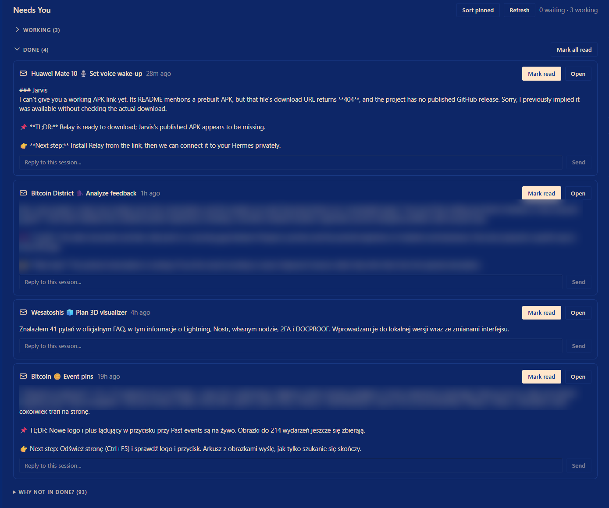

# 🔔 Needs You Hub

**One page for every question your Hermes sessions ask.**

Run five sessions at once and sooner or later one of them stops and waits for you, and you only find out when you click into the right tab. Needs You Hub collects every pending question and approval from all your live sessions onto one page. Answer them all in one place and get back to work.

[🌐 Landing page](https://itstomekk.github.io/needsyou-hub/) · [📦 Install](#-install-in-3-steps) · [🛠️ Development notes](DEVELOPMENT.md) · [📖 Desktop plugin SDK](https://hermes-agent.nousresearch.com/docs/developer-guide/desktop-plugin-sdk) · [👋 Made by Tomek](https://github.com/itstomekk)

<p align="center">
  
</p>

## ✨ What it does

- **🙋 Needs you**: every pending question (clarify) and approval (allow or deny) from every live session, as a card. Pick a choice or type your own answer, press send. Multi-question batches and multi-select work too.
- **⚙️ Working**: sessions that are running right now, with their sub-agents. Reply to one without leaving the page.
- **✅ Done**: sessions that finished since you last looked, with the last message shown. Reply, open, or **Mark read**. A long backlog can be hidden by setting the optional `DONE_SINCE_S` cutoff in `plugin.js` (off by default; see [DEVELOPMENT.md](DEVELOPMENT.md)).
- **📍 Status bar chip**: `needs you 2` at the bottom of the app. Click it to open the page.
- **🔔 Toast**: a small notice when a new question arrives from a session you are not looking at.
- **🔁 Auto-recovery**: questions that were already waiting when the plugin loaded (or when the app restarted) are picked up on their own. A **Load question** button is there as a fallback.

## 📦 Install in 3 steps

1. Download [`plugin.js`](plugin.js).
2. Put it at `%LOCALAPPDATA%\hermes\desktop-plugins\needs-you-hub\plugin.js`. The folder must be called `needs-you-hub` (the repo is `needsyou-hub`, the plugin folder is not).
3. In Hermes press **Ctrl+K**, run **Reload desktop plugins**. **Needs You** shows up in the sidebar.

Built against Hermes desktop v0.22.x. No build step, no dependencies.

## 🧭 What to try first

1. Open **Needs You** from the sidebar. With nothing pending it says **All clear**.
2. Start two sessions and ask each one something that makes it ask you a question. Watch the `needs you` chip count up.
3. Answer one card from the hub. Switch to that session and check that it carried on.
4. Finish a session, then press **Mark read** on its card in **Done**.

## ⚠️ Limits, in plain words

- **Tested on Windows** with desktop v0.22.x. Other systems and later versions are untested. The plugin talks to the app through calls I read out of the app itself, not from the docs, so a big app update can break it.
- **Passwords and sudo prompts are not covered.** Only questions and allow/deny approvals.
- **Sending answers is tested against a mocked app** (`node test.mjs`). Not every kind of prompt has been answered live from the page yet, approvals least of all.
- **"Mark read" is the plugin's own memory.** The app's green dots in the sidebar are only cleared on a best-effort basis.
- The **Sort pinned** button on the page reorders your pinned sessions, newest first. It is a one-off, and it was written from an assumed response shape that has not been checked live.

## 🧪 Test

```bash
node test.mjs
```

Runs the logic against a mocked SDK and prints `ALL PASS`.

## 🙏 Credits

Inspired by [needs-you](https://github.com/aydnOktay/hermes-needs-you) (an approvals page) and the `hermes inbox` plugin.

## 📄 License

MIT. See [LICENSE](LICENSE). Made by [Tomek](https://github.com/itstomekk). Issues and ideas are welcome.
